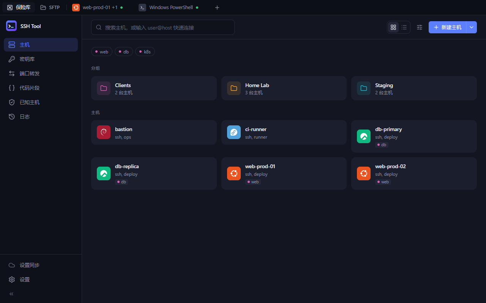
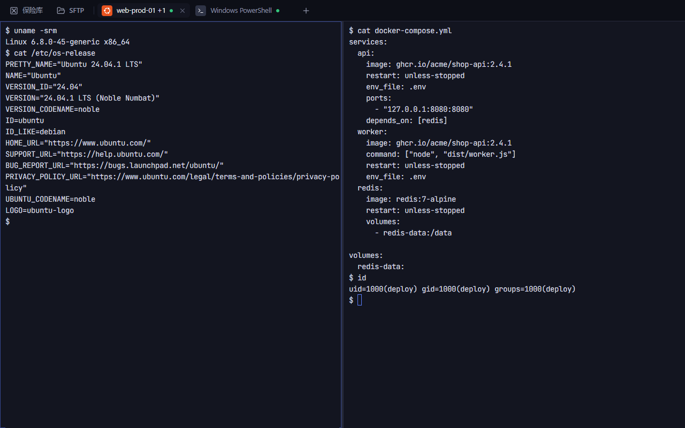
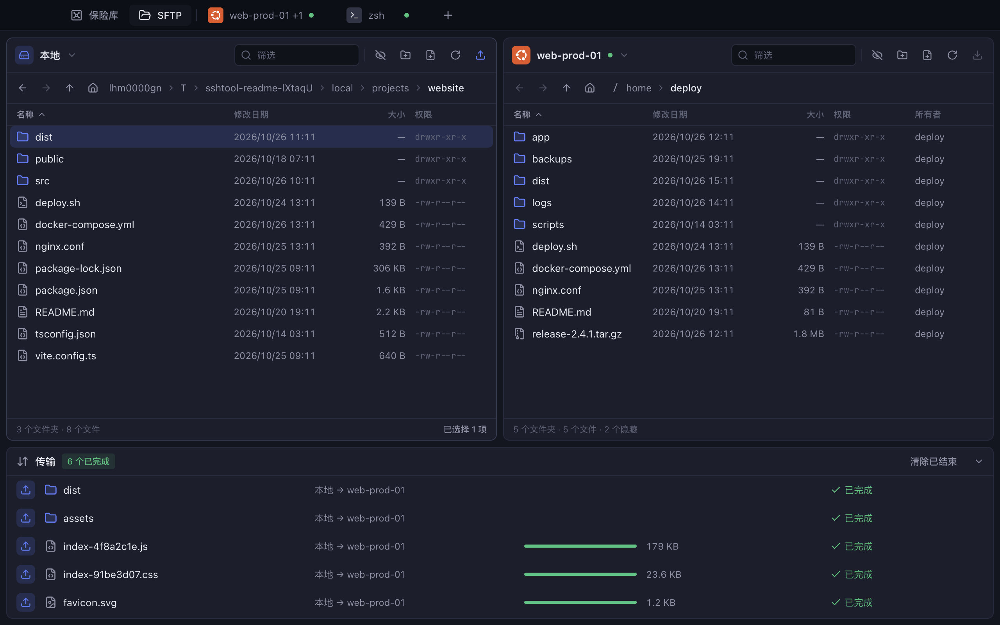
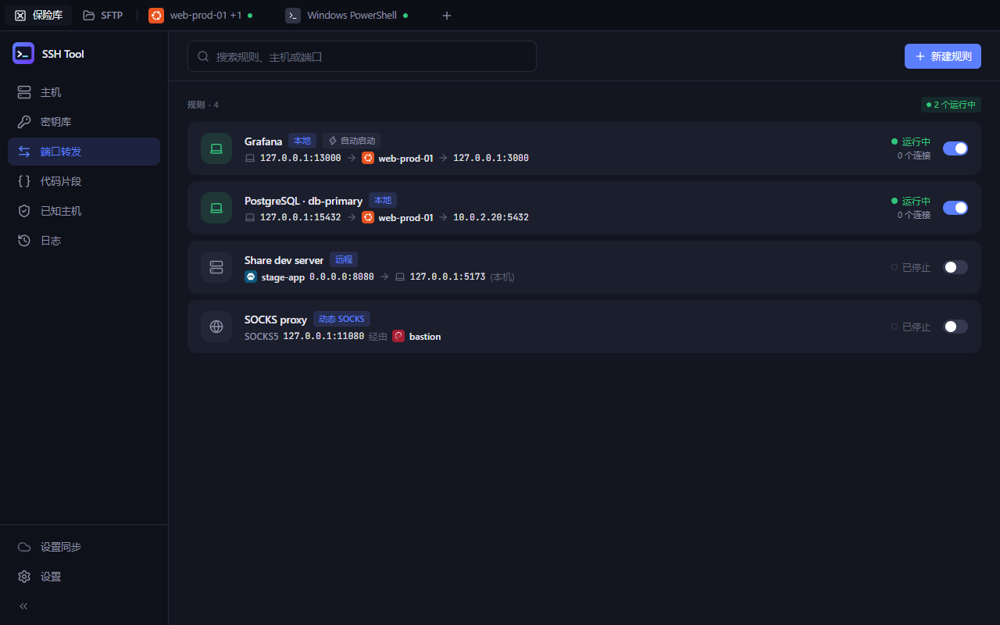
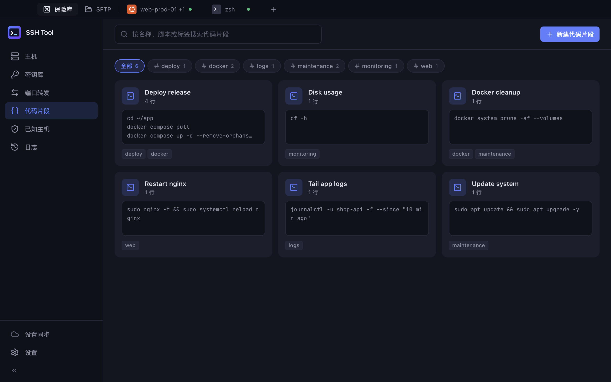
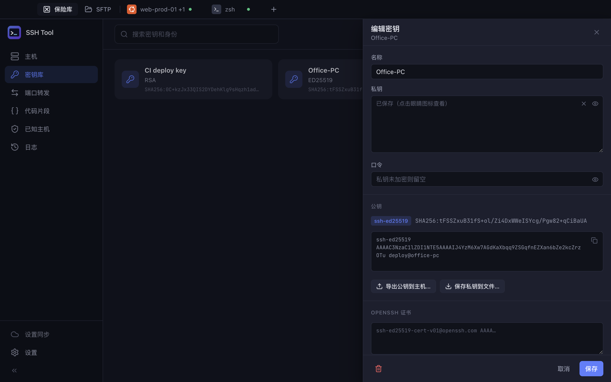
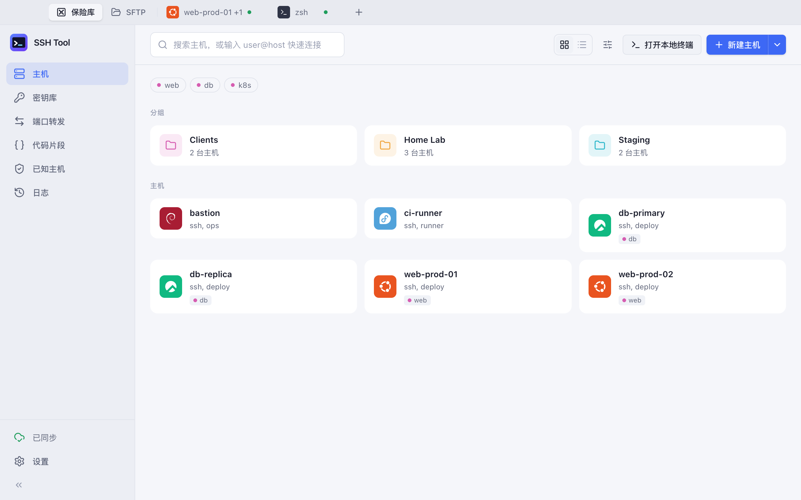
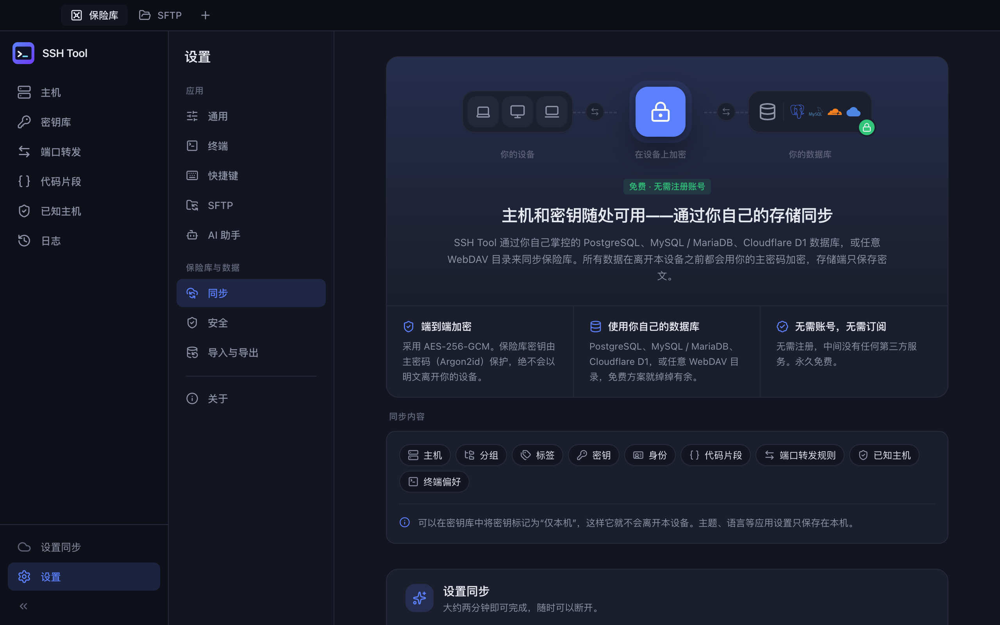
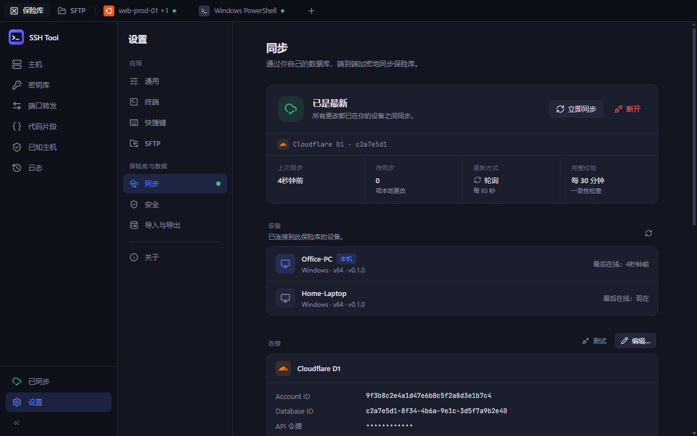

# SSH Tool · 免费自托管同步

**简体中文** | [English](README.en.md)

> 跨平台 SSH 客户端，功能对标 Termius。同步不收费、不经过官方服务器：数据存进你自己的 PostgreSQL、MySQL / MariaDB 或 Cloudflare D1，主密码端到端加密，数据库里只有密文。支持离线使用与自动合并。

支持 Windows、macOS 与 Linux，界面提供简体中文与英文。



<sub>本项目与 Termius 没有任何关联，未使用 Termius 的商标、图标或其它素材。</sub>

---

## 功能

| 模块 | 功能 |
| --- | --- |
| 主机 | 分组（可嵌套，组内默认设置自动继承）、标签、网格/列表视图、搜索与排序、多选批量操作、拖拽移动到分组、右键菜单、`user@host -p 端口` 快速连接、自动识别远端系统并显示发行版图标 |
| 终端 | 多标签页、拖拽排序、左右/上下分屏、广播输入（一次输入发送到所有分屏）、终端内查找、复制即选中、右键粘贴、缩放、可点击链接、18 套配色、主机级配色/字号覆盖、命令自动补全（基于历史与代码片段）、保存输出 |
| 连接 | 密码 / 私钥（OpenSSH、PEM、PuTTY PPK，支持口令）/ SSH Agent（Pageant、OpenSSH Agent、`SSH_AUTH_SOCK`）/ 键盘交互（二次验证）；主机链（多级跳板机）、SOCKS4/5 与 HTTP 代理、Agent 转发、保活、环境变量、登录后自动执行脚本、GBK 等字符编码；首次连接校验主机指纹、指纹变更强提醒；断线一键/回车重连 |
| 其它协议 | 本地终端（PowerShell / pwsh / cmd / WSL / Git Bash / zsh / bash…）、Telnet、串口（波特率、数据位、校验、流控、回显、换行符，可保存配置） |
| SFTP | 双栏文件管理（本地 ⇄ 远程、远程 ⇄ 远程）、拖拽上传下载（也支持从系统文件管理器拖入）、递归传输、传输队列（并发、进度、速度、取消、重试）、同名冲突处理（覆盖/跳过/保留两者）、权限修改、内置编辑器、调用外部程序编辑并在保存后自动上传 |
| 密钥库 | 生成 Ed25519 / RSA / ECDSA 密钥、导入私钥文件或粘贴、查看公钥与指纹、一键把公钥导出到主机的 `authorized_keys`、身份（可复用的用户名+密码/密钥）、密钥可设为「仅本机」不同步 |
| 端口转发 | 本地转发、远程转发、动态转发（内置 SOCKS5），规则管理、启动/停止、自动启动、状态与连接数 |
| 代码片段 | 片段管理（Shell 高亮编辑器、标签）、在当前终端运行、一键在多台主机上运行、终端侧边栏快速插入 |
| 已知主机 / 日志 | 主机指纹管理（可从 `~/.ssh/known_hosts` 导入，并在设备间同步）、连接历史 |
| 设置 | 中英文界面（默认中文）、深色/浅色/跟随系统、终端外观、可自定义快捷键、SFTP 选项、应用锁（启动/闲置自动锁定）、导入导出（`~/.ssh/config`、CSV、加密备份） |
| **多设备同步** | 自建数据库：PostgreSQL（实时推送）、MySQL / MariaDB、Cloudflare D1；端到端加密；离线可用、恢复联网后自动合并；设备列表、修改主密码、轮换密钥 |

---

## 截图

<table>
  <tr>
    <td align="center"><br><sub>终端：多标签、分屏</sub></td>
    <td align="center"><br><sub>SFTP：本地 ⇄ 远程双栏、传输队列</sub></td>
  </tr>
  <tr>
    <td align="center"><br><sub>端口转发：本地 / 远程 / 动态 SOCKS</sub></td>
    <td align="center"><br><sub>代码片段：按标签筛选、在多台主机上运行</sub></td>
  </tr>
  <tr>
    <td align="center"><br><sub>密钥库：生成、导入、导出公钥到主机</sub></td>
    <td align="center"><br><sub>浅色主题</sub></td>
  </tr>
</table>

---

## 多设备同步

<table>
  <tr>
    <td align="center"><br><sub>设置同步：数据存进你自己的数据库</sub></td>
    <td align="center"><br><sub>同步状态与设备列表</sub></td>
  </tr>
</table>

### 工作原理

- **端到端加密**：首次启用同步时设置一个**主密码**。主密码经 Argon2id 派生出密钥，用来加密一把随机生成的「保险库密钥」，
  所有主机、密钥、片段等数据在本机用保险库密钥（AES-256-GCM）加密后才会上传。数据库里只保存：条目 ID、密文、时间戳、删除标记和序号——
  连主机地址、条目类型都看不到。
- **冲突处理**：每个条目都带有混合逻辑时钟（HLC）时间戳，按条目「最后写入者胜出」；删除以墓碑形式同步。设备时钟不准也不会出错。
- **增量 + 全量校验**：平时按序号增量拉取，并定期做一次全量比对，修复任何不一致（例如数据库被恢复到旧备份）。
- **同步时机**：本地修改后约 1.5 秒自动推送；PostgreSQL 通过 `LISTEN/NOTIFY` 实时接收其它设备的修改；MySQL 和 D1 定时轮询（默认 30 / 60 秒，可调）；
  窗口获得焦点、网络恢复时也会同步。
- **会同步的数据**：主机、分组、标签、密钥、身份、代码片段、端口转发规则、已知主机、终端偏好与快捷键。
  不会同步：数据库连接信息、窗口状态、语言/主题、应用锁设置、连接日志、串口配置（端口名因设备而异）。

> ⚠️ **主密码无法找回**，修改主密码也需要输入当前主密码。已登录的设备不受影响，可以继续使用和同步。
> 如果忘了主密码又要添加新设备：在任一已登录设备上「断开」同步，换一个新的数据库（或在「高级 → 表名前缀」中换一个前缀），
> 用新的主密码重新创建保险库（本机数据会全部重新上传），再让其它设备加入新的保险库。

### 在第二台设备上加入

在另一台设备上打开「设置 → 同步」，选择同一个数据库、填写同样的连接信息，输入主密码即可「加入」。
新设备本地已有的数据会与云端合并。

### PostgreSQL（推荐，支持实时同步）

可以使用自建服务器（见 [`deploy/docker-compose.postgres.yml`](deploy/docker-compose.postgres.yml)），
也可以使用 Supabase、Neon、Aiven 等提供免费额度的托管 PostgreSQL。建议创建一个专用的数据库和用户：

```sql
CREATE USER sshtool WITH PASSWORD '一个足够长的随机密码';
CREATE DATABASE sshtool OWNER sshtool;
```

在 SSH Tool 中填写连接地址，例如 `postgres://sshtool:密码@db.example.com:5432/sshtool`，SSL 模式选择 `require`
（数据库可通过公网访问时请务必开启 TLS；若使用自签名证书，可选择 `verify-ca` 并粘贴 CA 证书）。

### MySQL / MariaDB

自建可参考 [`deploy/docker-compose.mysql.yml`](deploy/docker-compose.mysql.yml)。最小权限用户：

```sql
CREATE DATABASE sshtool CHARACTER SET utf8mb4;
CREATE USER 'sshtool'@'%' IDENTIFIED BY '一个足够长的随机密码';
GRANT SELECT, INSERT, UPDATE, DELETE, CREATE, INDEX ON sshtool.* TO 'sshtool'@'%';
```

连接地址示例：`mysql://sshtool:密码@db.example.com:3306/sshtool`。本地测试覆盖 MySQL 8.0 与 9.x，CI 还会在 MySQL 8.4 与 MariaDB 11 上运行同一套一致性测试。

### Cloudflare D1

D1 是 Cloudflare 的 Serverless SQLite，免费额度对个人同步绰绰有余，且无需自己维护服务器。SSH Tool 通过 Cloudflare 官方 HTTP API 直接访问，不需要部署 Worker。

1. 在 Cloudflare 控制台 **Workers & Pages → D1 SQL Database → Create** 创建一个数据库（或执行 `npx wrangler d1 create sshtool`）。
2. 在 **My Profile → API Tokens → Create Token → Create Custom Token** 中创建令牌，权限选择 **Account → D1 → Edit**，
   账户资源选择你的账户（可以额外设置客户端 IP 白名单）。
3. 在 SSH Tool 中填写 **Account ID**（控制台首页右侧或 URL 中）、**Database ID**（D1 数据库详情页）与 **API Token**。

> 注意：D1 Edit 权限的令牌可以访问该账户下的**所有** D1 数据库，建议为同步单独使用一个 Cloudflare 账户；
> 即使令牌泄露，对方也只能看到密文，但可以删除数据——请定期在「设置 → 导入与导出 → 加密备份」中导出备份。
> Cloudflare API 有全局速率限制（约 1200 次 / 5 分钟），SSH Tool 默认 60 秒轮询一次并做了退避处理，正常使用远低于该限制。

### 安全建议

- 数据库开启 TLS，使用强密码和专用低权限用户，尽量配置 IP 白名单。
- 发现设备丢失时，在其它设备上「轮换保险库密钥」（设置 → 同步）：会生成新密钥并重新加密全部数据，丢失的设备将无法再解密新数据。
- 本机数据库同样是加密存储的；保险库密钥由操作系统钥匙串保护（Windows DPAPI / macOS 钥匙串 / Linux Secret Service）。
  在没有钥匙串服务的 Linux 上，请在「设置 → 安全」中启用应用锁密码。
- 如果系统钥匙串无法取回密钥（例如 Linux 更换了桌面环境或钥匙串、拒绝了 macOS 钥匙串访问、把数据目录复制到了另一台电脑），
  启动时会显示「无法打开本机保险库」，可以重试，或重置本机数据后在「设置 → 同步」中用主密码重新加入以恢复数据。
  忘记应用锁密码时，可在锁定界面点击「忘记密码？」做同样的重置。

---

## 安装

在 [Releases](../../releases) 下载对应平台的安装包：

- **Windows**：`ssh-tool-<版本>-win-x64-setup.exe`（安装版）或 `-portable.exe`（便携版）。未签名的安装包可能触发 SmartScreen 提示，点击「更多信息 → 仍要运行」。
- **macOS**：`ssh-tool-<版本>-mac-arm64.dmg`（Apple 芯片）/ `-mac-x64.dmg`（Intel）。安装包未经 Apple 公证，首次打开被拦截时，
  请到「系统设置 → 隐私与安全性」点击「仍要打开」，或执行 `xattr -dr com.apple.quarantine "/Applications/SSH Tool.app"`。
- **Linux**：`AppImage`、`deb`、`rpm`，提供 x64 与 arm64。Ubuntu / Debian 推荐使用 deb：会自动配置 Chromium 沙箱与 AppArmor，并加入应用菜单。
  AppImage 需要 FUSE 2，Ubuntu 22.04 及以上请先安装（24.04：`sudo apt install libfuse2t64`；22.04：`sudo apt install libfuse2`），然后 `chmod +x` 后直接运行。

数据目录：Windows `%APPDATA%\SSH Tool`，macOS `~/Library/Application Support/SSH Tool`，Linux `~/.config/SSH Tool`。

---

## 从源码构建

需要 Node.js 22+。

```bash
npm ci
npm run dev          # 开发模式（热更新）
npm test             # 单元测试 + 集成测试（内置 SSH 测试服务器、D1 模拟服务、内嵌 PostgreSQL）
npm run test:e2e     # 端到端测试（Playwright 驱动真实应用：建主机→SSH 终端、同步向导、两台设备同步、重启后继续同步、对话框、钥匙串故障恢复）
npm run screenshots  # 重新生成 README 截图（docs/screenshots，中英文各一套）
npx electron-builder --dir && npm run test:package   # 打包当前平台并做冒烟测试（安装包内容、签名、原生模块）
npm run typecheck
npm run dist:win     # 打包 Windows（在 Windows 上执行）
npm run dist:mac     # 打包 macOS（在 macOS 上执行）
npm run dist:linux   # 打包 Linux（在 Linux 上执行）
```

原生模块（node-pty、serialport）均为 N-API 预编译版本，Windows 与 macOS 无需安装编译工具；Linux 上 node-pty 会在 `npm ci` 时编译（需要 `build-essential`、`python3`）。
三个平台的安装包需要分别在对应系统上构建——推送 `v*` 标签后，GitHub Actions（[`.github/workflows/release.yml`](.github/workflows/release.yml)）会自动构建全部平台并发布到 Releases。

可选的测试环境变量：`SSHTOOL_TEST_MYSQL=1`（下载并启动临时 MySQL 测试同步适配器）、`SSHTOOL_TEST_PG_URL` / `SSHTOOL_TEST_MYSQL_URL`（使用外部数据库）、
`CF_ACCOUNT_ID` + `CF_D1_DATABASE_ID` + `CF_API_TOKEN`（使用真实的 Cloudflare D1）。

---

## 常用快捷键

| 操作 | Windows / Linux | macOS |
| --- | --- | --- |
| 命令面板 / 快速连接 | `Ctrl+Shift+K` 或 `Ctrl+Shift+T` | `⌘K` / `⌘T` |
| 关闭标签页 | `Ctrl+Shift+W` | `⌘W` |
| 切换标签页 | `Ctrl+Tab` / `Alt+1…9` | `⌃Tab` / `⌘1…9` |
| 本地终端 | ``Ctrl+Shift+` `` | `⌘⇧T` |
| 向右 / 向下分屏 | `Ctrl+Shift+D` / `Ctrl+Shift+E` | `⌘D` / `⌘⇧D` |
| 广播输入 | `Ctrl+Shift+B` | `⌘⇧B` |
| 终端内查找 | `Ctrl+Shift+F` | `⌘F` |
| 复制 / 粘贴 | `Ctrl+Shift+C` / `Ctrl+Shift+V` | `⌘C` / `⌘V` |
| 打开 SFTP | `Ctrl+Shift+O` | `⌘⇧O` |
| 设置 | `Ctrl+,` | `⌘,` |

所有快捷键都可以在「设置 → 快捷键」中修改（并随同步在同类平台的设备间共享）。Windows/Linux 默认使用 `Ctrl+Shift` 组合，避免与 Shell 的 `Ctrl+W`、`Ctrl+K` 等冲突。

---

## 已知限制

- 不支持 Mosh（Windows 上没有官方 mosh-client）。
- OpenSSH 用户证书认证：SSH 库（ssh2）暂不支持，证书字段目前仅保存，不参与认证。
- MySQL 与 D1 没有推送通知，依赖轮询（可在同步设置中调整间隔）。
- 命令自动补全基于本地记录的命令历史，无法感知远端 Shell 的补全结果（可在设置中关闭）。

## 技术栈

Electron · React · TypeScript · Tailwind CSS · Radix UI · xterm.js · ssh2 · node-pty · serialport · CodeMirror · node:sqlite · pg · mysql2

## 许可证

[MIT](LICENSE)